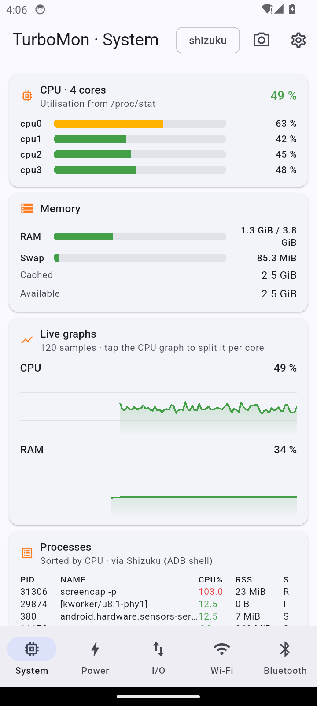
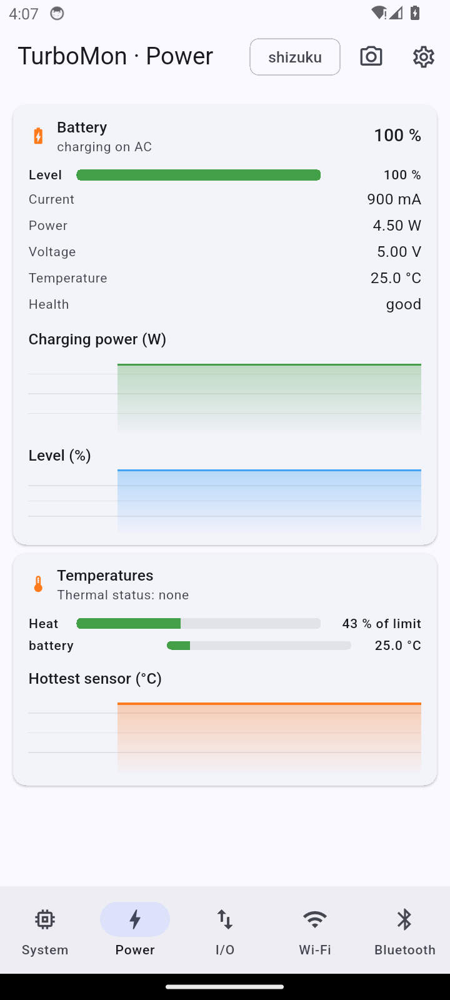
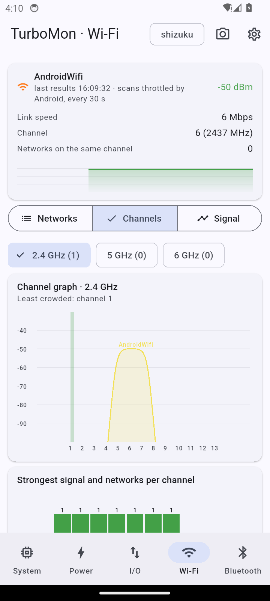
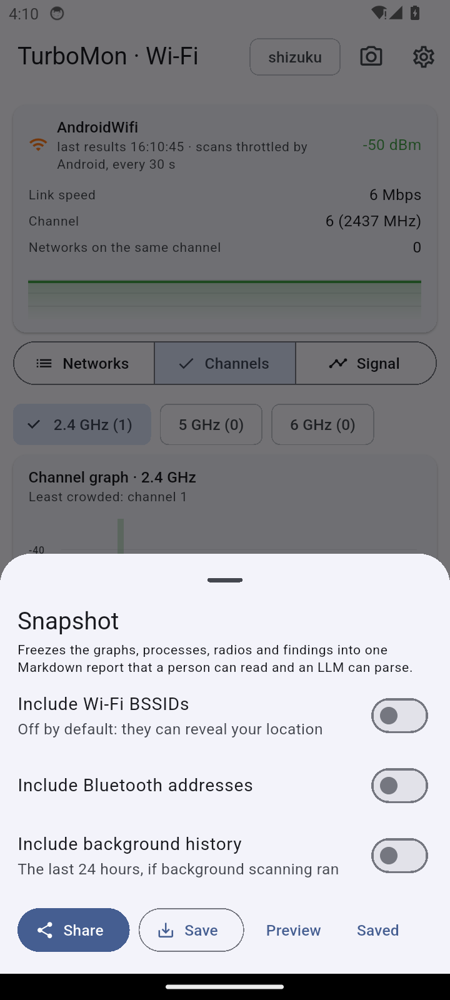
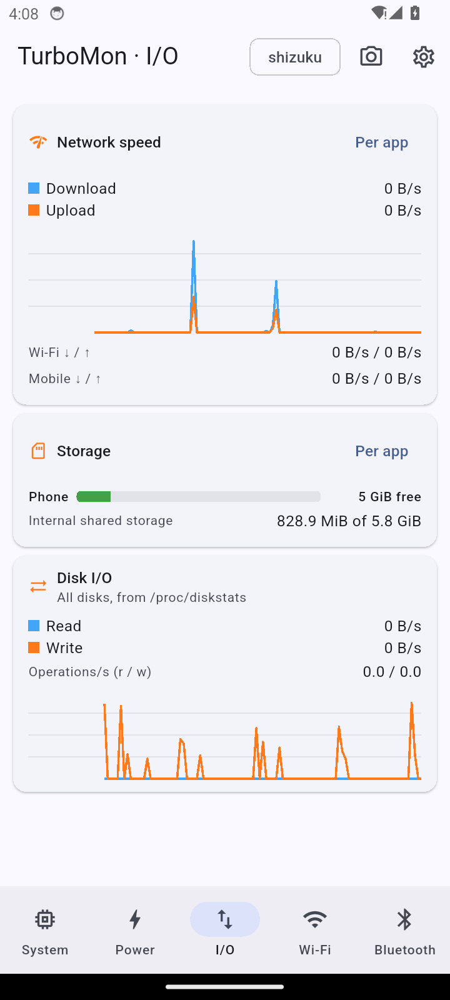
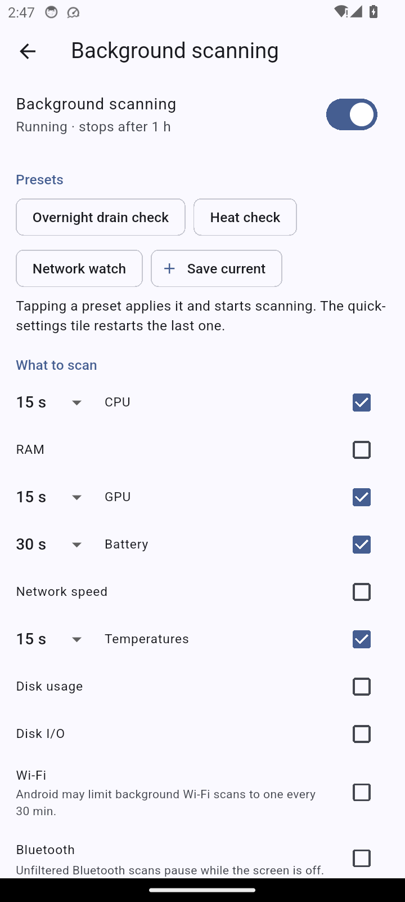
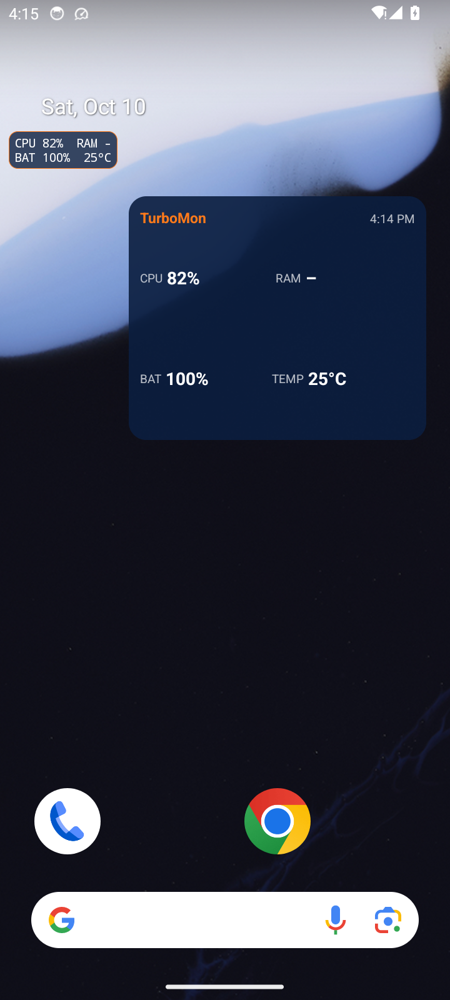

# TurboMon

A system monitor for Android: a `top`-style view of CPU, RAM and GPU, live
graphs that change colour with load, battery, temperatures, storage, disk
I/O, network speed, a Wi-Fi channel analyser and a Bluetooth scanner. When
something drains your phone, take a **snapshot**: a Markdown report you can
hand straight to an LLM to find the cause and the fix.

Everything stays on the phone: TurboMon has no internet permission.
Shizuku or root are optional and unlock real CPU %, the process list and
every thermal sensor.

  
  
  
  

  
  
  

## Install

Add [snonux's F-Droid repository](https://github.com/snonux/fdroid) to
F-Droid and install TurboMon from there; F-Droid keeps it updated.

- Address: `https://snonux.github.io/fdroid/repo`
- Fingerprint: `04B05FB0565543E058372B867B3D3A699D9D668388CE670478EDD4116D736DF7`

## Docs

- [Features](./docs/features.md): what every screen shows and how.
- [Permissions](./docs/permissions.md): why each one is asked for, and when.
- [Shizuku and root](./docs/shizuku-and-root.md): the optional extras they unlock.
- [Background scanning](./docs/background-scanning.md): what runs, how often, and how it stops.
- [Snapshot format](./docs/snapshot-schema.md): the report an LLM reads.
- [Building](./docs/building.md), [testing](./docs/testing.md) and [releasing](./docs/releasing.md).
- [Phone testing handoff](./docs/phone-testing-handoff.md): what is left to test on a real phone, for the next agent.

## License

MIT, see [LICENSE](./LICENSE).
